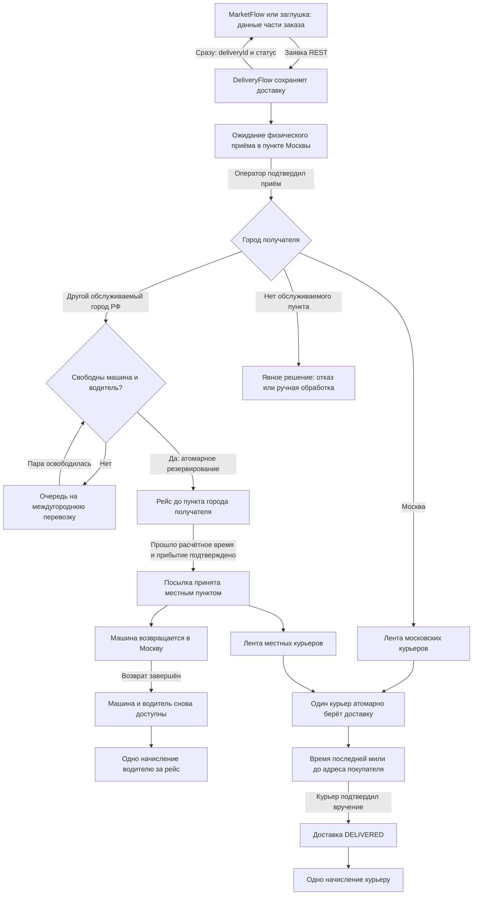
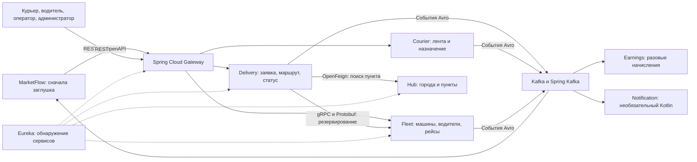

# Модель работы DeliveryFlow

Это **2D-модель целевого поведения**. Она дополняет [идею проекта](PROJECT_IDEA.md) и [этапы разработки](DEVELOPMENT_PLAN.md), но не означает, что все блоки уже написаны. Публичные запросы и ответы первой заявки описаны в [OpenAPI](../openapi/delivery-api.v1.yaml).

## Путь посылки и машины

Ветви после прибытия в местный пункт **независимы**: курьер может вручить товар, пока машина возвращается. Плановое время запускает проверку этапа, но не должно подменять факт физического приёма или вручения. Автоподтверждение по таймеру допустимо только в явно обозначенной учебной симуляции.

## Где находятся технологии

Первая работающая версия — одно приложение с внутренними модулями. Следующая схема показывает **целевые границы после разделения на сервисы**; пунктирные связи и перечисленные продукты не следует считать уже существующими.

| Инструмент | Задача в модели |
| --- | --- |
| Java 21, Maven, Spring Boot | Код и сборка приложений; вначале — один `delivery-service`. |
| Spring MVC, OpenAPI/Swagger | Синхронные REST-запросы от заглушки MarketFlow и интерфейсов сотрудников. Контракт пишется до реализации; Swagger помогает его просматривать. |
| Spring Security | Bearer-аутентификация сервисного клиента и разграничение действий курьера, водителя, оператора и администратора. Источник токенов надо определить отдельно. |
| Spring Data JPA, Hibernate, PostgreSQL, Flyway | Надёжно хранить доставки, пункты, курьеров, назначения, машины, водителей, рейсы, сроки и начисления; изменять схему версионированными миграциями. После разделения каждый сервис владеет своими таблицами или БД. |
| Планировщик Spring | Обрабатывать сохранённые сроки прибытия, доставки и возврата после перезапуска приложения; не удерживать HTTP-запрос во время поездки. |
| Caffeine | Кэшировать редко меняющиеся данные о пунктах и тарифах. Не кэшировать как источник истины свободные машины или задания курьеров. |
| Kafka, Spring Kafka, Apache Avro | Передавать факты об изменениях асинхронно: прибытие, вручение, завершение рейса. Avro задаёт схему событий. Kafka не заменяет атомарное резервирование ресурсов. |
| OpenFeign | Позже — простой синхронный REST-вызов справочника пунктов между сервисами. Пока модули в одном приложении, достаточно обычного Java-вызова. |
| gRPC, Protocol Buffers | Позже — внутренний синхронный контракт резервирования машины и водителя в `fleet-service`. |
| Resilience4j | Тайм-ауты и обработка недоступности удалённых сервисов; недоступность `fleet-service` означает ожидание или ошибку, а не «резервирование выполнено». |
| Spring Cloud Gateway, Eureka | После разделения — единая внешняя точка входа и обнаружение запущенных сервисов. |
| Docker, Docker Compose | Позже — совместный запуск приложений, PostgreSQL, Kafka и инфраструктуры; локальный PostgreSQL подходит для начальных этапов. |
| JUnit 5, Mockito, Testcontainers | Проверять бизнес-правила, конкурентные назначения и интеграцию с реальными PostgreSQL/Kafka на протяжении разработки. |

## Разделение данных и состояний

| Сущность | За что отвечает |
| --- | --- |
| `Delivery` | Одна посылка/часть заказа, адреса, получатель и текущий этап доставки. Текущая таблица `deliveries` содержит лишь начальные данные этого процесса. |
| `Hub` | Главный московский и местные логистические пункты, обслуживаемые города. |
| `Vehicle` и `Driver` | Отдельная доступность машины и водителя. Машина может быть доступна, ехать к городу или возвращаться; это не статус доставки. |
| `Trip` | Назначенные машина и водитель, город назначения, отправление, расчётное прибытие и возврат. |
| `Courier` и `CourierAssignment` | Город курьера и единственное активное назначение конкретной доставки. |
| `DeliveryEvent` | История подтверждённых событий: приём в пункт, прибытие, взятие курьером, вручение. |
| `Earning` | Разовое виртуальное начисление с основанием и сохранённым тарифом; не банковский перевод. |

Новые таблицы вводим **новыми миграциями Flyway**. Если `V1__create_deliveries.sql` уже применена к какой-либо БД, её нельзя редактировать задним числом. Текущий OpenAPI пока описывает только создание заявки: первоначальный `WAITING_FOR_COURIER`, разрешённый код страны и `pickupAddress` требуют отдельного согласования с целевой схемой московского пункта и новых статусов.
